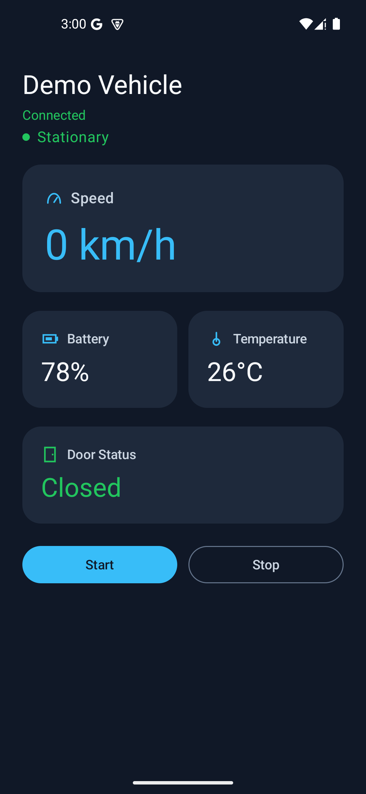

# Vehicle Service Simulator

An Android practice project that shows simulated vehicle data flowing from a Service in a separate process to a Jetpack Compose dashboard. Built with Kotlin to demonstrate Service lifecycle, AIDL callbacks, and testable simulation logic. No vehicle hardware or backend is involved.



## Features

- Live dashboard for speed, battery, temperature, door status, and Service connection status.
- Start/Stop controls for a simulation that updates about once per second and retains the last state when stopped.
- Bounded mock values, including zero speed when the battery is empty and a closed door while moving.
- Activity lifecycle binding and protection against callbacks from an older Service connection.

## Tech Stack

- **Language and state:** Kotlin 2.2.10, coroutines, `StateFlow`, and AndroidX ViewModel.
- **UI:** Jetpack Compose and Material 3.
- **Android IPC:** Started and Bound Service in the `:vehicle` process, AIDL callbacks, and a Parcelable snapshot.
- **Build and tests:** Gradle 9.6.0, Android Gradle Plugin 9.4.1, JUnit 4, and AndroidX instrumentation tests.

## Architecture

The app has one `:app` module. `VehicleDataService` owns the simulation loop in a separate process. `MainActivity` sends Start/Stop Intents and binds while started; `VehicleViewModel` turns callback snapshots into state for the dashboard.

```text
Start/Stop button -> Intent -> VehicleDataService (:vehicle)
VehicleSimulationEngine -> VehicleDataService -> IVehicleStateCallback (AIDL)
    -> VehicleSnapshot (Parcelable) -> VehicleViewModel (StateFlow) -> Compose dashboard
```

The Service sends the current snapshot when a callback registers and unregisters callbacks when the UI disconnects. See [architecture details](docs/ARCHITECTURE.md) for lifecycle and process-death behavior.

## Run the demo

Requirements: Android Studio with Android SDK 37.0, JDK 25, and an emulator or device running Android 8.0 (API 26) or later. The repository includes the Gradle wrapper.

1. Open the repository in Android Studio and run the `app` configuration.
2. Wait for **Connected**, then tap **Start**. The Service publishes a new simulated state about once per second.
3. Tap **Stop** to retain the latest values and stop updates. Leave and reopen the Activity to see it bind again.

The Service is not a foreground service. Android may stop it while the app is in the background, and the state resets if the `:vehicle` process dies.

## Tests

On Windows:

```powershell
.\gradlew.bat assembleDebug testDebugUnitTest lintDebug
.\gradlew.bat connectedDebugAndroidTest
```

The second command requires a running emulator or connected device. On macOS/Linux, use `./gradlew` in place of `.\gradlew.bat`.

Unit tests cover simulation bounds and transitions. Instrumentation tests cover Parcel round trips, callback registration and removal across the process boundary, repeated Start/Stop commands, Activity unbind/rebind and background unbind, and callback error handling. [Android CI](.github/workflows/android-ci.yml) is configured to run build, unit tests, lint, and instrumentation tests on an API 35 emulator; the new CI emulator step still needs its first GitHub run.

## Project scope

All data is simulated. There is no CAN/OBD integration, persistence, network service, or background tracking guarantee. See [architecture](docs/ARCHITECTURE.md) and [project scope and task status](docs/PROJECT.md) for details.
